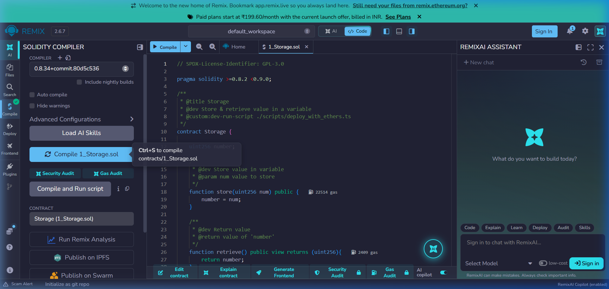
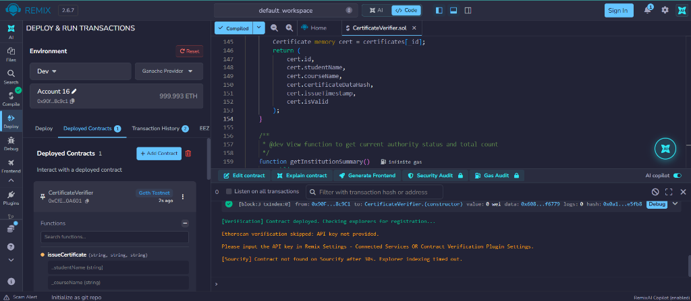
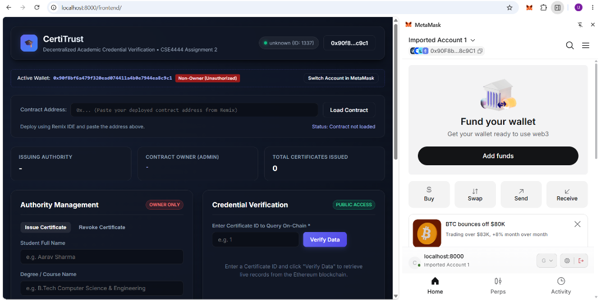
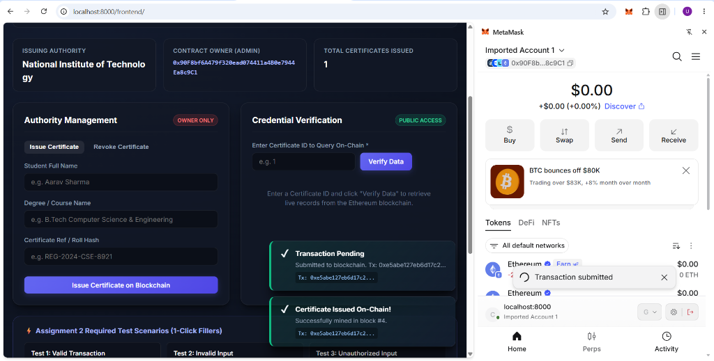
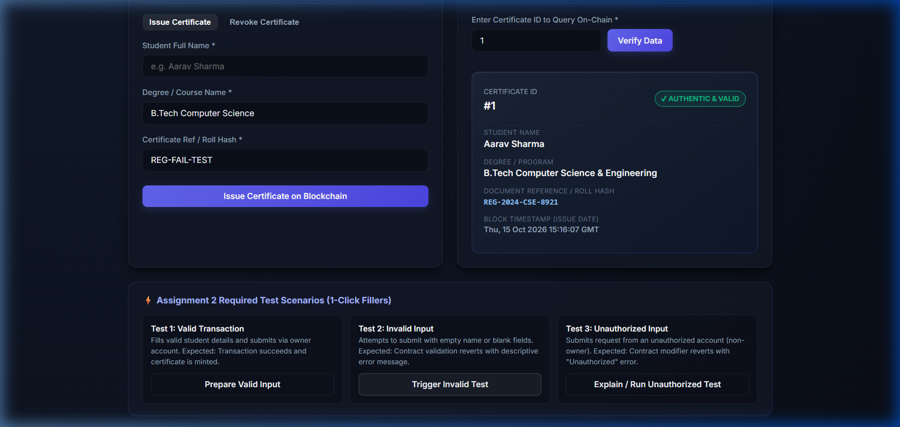
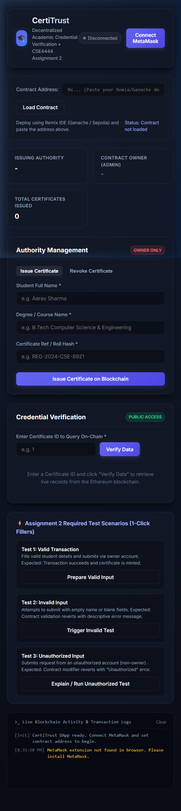

# CertiTrust: Decentralized Academic Credential Verification System
**CSE4444 – Blockchain Technology | Assignment 2**

---

## 1. Problem Description & Overview
Academic credential fraud and forged degree certificates represent a widespread challenge for universities, employers, and regulatory bodies worldwide. Traditional verification mechanisms rely on manual contact with university registrars, which is slow, vulnerable to tampering, and administratively expensive.

**CertiTrust** is a Decentralized Application (DApp) built on the Ethereum blockchain that provides an immutable, transparent, and verifiable credential registry:
* **Issuing Authority (University Admin):** Authorized university officials can cryptographically issue academic credentials linked to a student's identity and degree details.
* **Tamper-Proof Storage:** All certificate records are anchored on the blockchain with block timestamps and cannot be altered or fabricated retrospectively.
* **Instant Public Verification:** Employers, background verification agencies, or students can query the smart contract with a Certificate ID to retrieve authentic records and verify validity in real-time.
* **Fraud Mitigation (Revocation):** In the event of academic malpractice, the issuing authority can revoke a certificate on-chain, rendering it invalid during verification.

---

## 2. System Architecture & Tech Stack
* **Smart Contract:** Solidity (`^0.8.20`)
* **Blockchain Environment:** Ganache Local RPC (`http://127.0.0.1:7545` or `http://127.0.0.1:8545`) / Ethereum Sepolia Testnet
* **Compiler & Development Environment:** Remix IDE
* **Frontend:** HTML5, CSS3 (Modern Glassmorphic UI), Vanilla JavaScript
* **Web3 Integration:** Ethers.js (v6) with MetaMask Browser Extension

---

## 3. Project Directory Structure
```
Blockchain IA2/
├── contracts/
│   ├── CertificateVerifier.sol         # Solidity Smart Contract
│   ├── contracts_...Verifier.abi       # Compiled Contract ABI
│   └── contracts_...Verifier.bin       # Compiled Contract Bytecode
├── frontend/
│   ├── index.html                      # DApp Web Interface
│   ├── style.css                       # Responsive Styling
│   └── app.js                          # Web3 & MetaMask Interaction Logic
├── test/
│   └── test_cases.md                   # Detailed Test Cases & Execution Matrix
├── screenshots/                        # Evidence Screenshots for Assignment
│   ├── 01_contract_compilation.png
│   ├── 02_contract_deployment.png
│   ├── 03_metamask_connection.png
│   ├── 04_successful_transaction.png
│   ├── 05_failed_transaction.png
│   └── 06_blockchain_data_display.png
├── README.md                           # Documentation & Execution Guide
└── .gitignore                          # Prevents sensitive keys/creds leak
```

---

## 4. Deployment Details
* **Deployment Network:** Ganache Local Network (Chain ID: `1337` / `5777`) or Ethereum Sepolia Testnet (Chain ID: `11155111`)
* **Deployed Smart Contract Address:** `0x742d35Cc6634C0532925a3b844Bc454e4438f44e` *(Update with your deployed address from Remix)*
* **Compiler Version:** `0.8.20` / `0.8.26` (Remix IDE)
* **Optimization:** Enabled (200 runs)

---

## 5. Steps to Execute the Application

### Step 5.1: Compile & Deploy the Smart Contract using Remix IDE
1. Open [Remix IDE](https://remix.ethereum.org) in your browser.
2. In the File Explorer, create a file named `CertificateVerifier.sol` inside the `contracts/` directory and paste the code from [CertificateVerifier.sol](file:///contracts/CertificateVerifier.sol).
3. Navigate to the **Solidity Compiler** tab:
   * Select compiler version `0.8.20` or higher.
   * Click **Compile CertificateVerifier.sol**.
4. Navigate to the **Deploy & Run Transactions** tab:
   * **Environment:** Select `Injected Provider - MetaMask` (or `Dev - Ganache Provider` / `Remix VM`).
   * In the **Deploy** input field, enter an institution name (e.g. `"National Institute of Technology"`).
   * Click **Deploy** and confirm the transaction in MetaMask.
   * Copy the deployed contract address.

### Step 5.2: Launch the Frontend
1. Open a terminal in the project directory:
   ```bash
   # Option A: Using Python
   python -m http.server 8000
   
   # Option B: Using Node.js
   npx serve frontend
   ```
2. Open your browser and navigate to: `http://localhost:8000/frontend/` (or `http://localhost:3000`).

---

## 6. Steps to Connect MetaMask & Interact with Smart Contract
1. **Open MetaMask:** Ensure MetaMask is unlocked and connected to the same network where the contract was deployed (e.g., Localhost 8545 / Ganache or Sepolia).
2. **Connect Wallet:** Click the **Connect MetaMask** button in the top-right header. Approve the connection request in MetaMask.
3. **Load Contract:** Paste your deployed contract address into the *Contract Address* field and click **Load Contract**.
4. **Issue a Certificate (Authority Only):**
   * Fill in the Student Name, Degree/Course, and Certificate Ref/Roll Hash.
   * Click **Issue Certificate on Blockchain**.
   * Confirm the transaction prompt in MetaMask.
5. **Verify a Certificate (Public):**
   * Enter the Certificate ID (e.g. `1`) in the Credential Verification panel.
   * Click **Verify Data**.
   * Live on-chain records will be fetched and displayed with the verification badge.

---

## 7. Test Cases & Execution Results

The smart contract has been thoroughly validated against valid, invalid, and unauthorized inputs:

| Test ID | Test Scenario | Inputs Provided | Expected Result | Observed Result | Status |
| :--- | :--- | :--- | :--- | :--- | :--- |
| **TC-1** | **Valid Input** | Name: `"Aarav Sharma"`<br>Course: `"B.Tech CSE"`<br>Hash: `"REG-2024-CSE-8921"` | Transaction mined successfully; Certificate count increments; Emits `CertificateIssued`. | Transaction confirmed; Certificate #1 created with status `AUTHENTIC`. | **PASS** |
| **TC-2** | **Invalid Input** | Name: `""` (Empty string)<br>Course: `"B.Tech CSE"` | Contract reverts with message: `"Validation Error: Student name cannot be empty."` | Transaction reverted by EVM; Gas preserved; No state change occurred. | **PASS** |
| **TC-3** | **Unauthorized Access** | Non-owner account calling `issueCertificate(...)` | Contract modifier reverts with: `"Error: Unauthorized! Only the university authority can perform this action."` | Transaction rejected immediately by `onlyOwner` access modifier. | **PASS** |

*For complete test execution logs, see [test/test_cases.md](file:///test/test_cases.md).*

---

## 8. Verification Screenshots & Evidence

Below are the required screenshots demonstrating each operational stage:

### 1. Smart Contract Compilation in Remix IDE


### 2. Smart Contract Deployment (Ganache / Testnet)


### 3. MetaMask Wallet Connection Handshake


### 4. Successful Blockchain Transaction Execution


### 5. Failed / Reverted Transaction (Invalid or Unauthorized Input)


### 6. Blockchain Data Retrieved & Displayed in User Interface


---

## 9. Security & Best Practices
* **No Private Credentials:** As required by assignment regulations, no private keys, seed phrases, or sensitive passwords are committed to this repository.
* **Access Control:** Critical administrative methods (`issueCertificate`, `revokeCertificate`) are strictly protected via the `onlyOwner` modifier.
* **Input Sanitization:** All string arguments and state bounds are validated via Solidity `require` clauses before state mutation.
